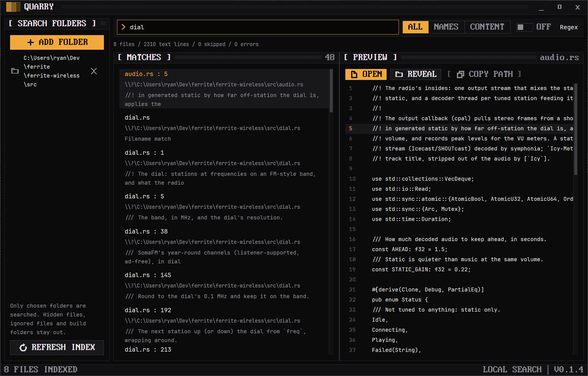

<p align="center">
  
</p>

<h1 align="center">Quarry</h1>

<p align="center">
  A native Ferrite file-search app: index filenames and text, search instantly, nothing uploaded.
</p>

<p align="center">
  <a href="https://github.com/rwetz/ferrite-quarry/actions/workflows/ci.yml"></a>
  <a href="https://github.com/rwetz/ferrite-quarry/releases/latest"></a>
  <a href="LICENSE"></a>
</p>



## Use

Add one or more search folders. After indexing, type a literal phrase and choose
All, Names or Content. Literal search normalizes Unicode lowercase (without accent stripping or full case folding). Enable Regex
for regular expressions. Select a match for a live file preview; Open uses the
system association, Reveal opens its location, and Copy path copies its path.
Ctrl+Shift+P opens the command palette. Ctrl+F focuses search, Ctrl+J/K moves
through results, and Ctrl+Enter opens the selected file. Refresh rebuilds the index after file
changes. Cancel interrupts indexing; removing a root removes it from the next
index. Folders are remembered and reindexed on startup.

## Search engine

Quarry implements the same candidate/verify idea used in Ryan's logscope:
normalize text, index overlapping three-byte sequences in sorted posting lists,
intersect the smallest postings first, then verify the actual substring.
Short queries and regex queries scan indexed documents. Regex candidate pruning
is deliberately deferred until a sound extraction implementation is available.
This engine is newly implemented here; no private logscope code or dependency is
included. Tests compare indexed results with brute-force matching.

## Boundaries in 0.1

- Only explicitly chosen roots are walked. Symlinks are not followed. Hidden
  files, ignore files (.gitignore/.ignore), and build/dependency directories
  (.git, target, node_modules, .next, __pycache__, .venv) are excluded.
- Filenames are indexed for binary and oversized files too. Content requires
  UTF-8 text without NUL bytes, files at most 2 MiB, and lines at most 16 KiB.
- The in-memory index stops at 32 MiB of source text, 200,000 documents, or four million posting entries.
  Index-limit, skipped-content and error counts are shown. Up to 500 matching
  documents are displayed, with the full indexed match count.
- Preview reads the current file; indexed matches describe the last scan.
  Refresh after changes. Preview is limited to 80 lines near the match.
- Index contents stay in memory. There is no automatic file watcher, on-disk
  index cache, PDF/Office extraction, fuzzy search, or file editing yet.

## Development

Requires Rust, platform GPUI dependencies, and the pinned ferrite-design revision.
Use modest build concurrency:

```powershell
cargo test -j 2
cargo clippy --all-targets -j 2 -- -D warnings
cargo run -j 2
cargo run -j 2 -- --scan ../logscope --query SearchIndex --content
```

The CLI uses the same scanner and index as the UI. --help lists its options.
Releases on main pushes include a Windows per-user setup installer and portable
platform archives. SHA256SUMS.txt covers all assets.

## Next milestones

1. Incremental updates through a debounced file watcher, with explicit pause.
2. Persisted index snapshots and unchanged-file reuse on startup.
3. Search term highlights and extension filters.
4. Benchmarks at 10k/100k files, peak memory measurement, and native layout QA.

## Keys

| Keys | |
|---|---|
| <kbd>Ctrl</kbd>+<kbd>F</kbd> | Focus search |
| <kbd>Ctrl</kbd>+<kbd>J</kbd> <kbd>K</kbd> | Move through results |
| <kbd>Ctrl</kbd>+<kbd>Enter</kbd> | Open the selected file |
| <kbd>Ctrl</kbd>+<kbd>Shift</kbd>+<kbd>P</kbd> | Command palette |
| <kbd>Ctrl</kbd>+<kbd>,</kbd> | Settings |

---

<p align="center">
  <picture>
    <source media="(prefers-color-scheme: dark)" srcset="docs/brand/heptagram-white.svg">
    
  </picture>
</p>
